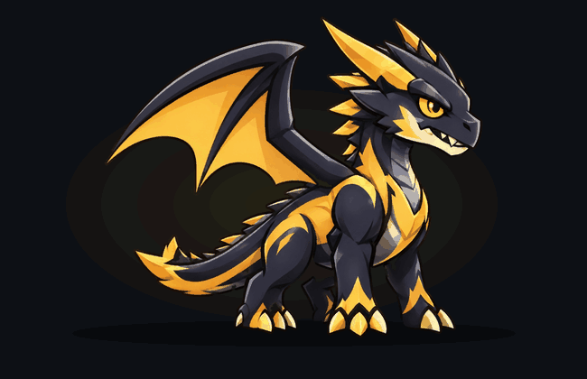
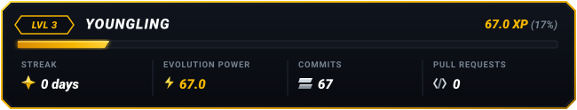

<p align="center">
  
  <br>
  
</p>

<p align="center">
  
</p>

<p align="center">
  
</p>

<p align="center">
  <strong>An animated dragon living in your GitHub README that breathes, blinks, and evolves from your real GitHub coding activity.</strong>
</p>

<p align="center">
  <a href="#quick-setup-60-seconds"></a>
  <a href="#evolution-tiers"></a>
  <a href="#about"></a>
  <a href="#how-it-works"></a>
  <a href="#color-palettes"></a>
  <a href="SETUP.md"></a>
  <a href="LICENSE"></a>
</p>

---

## Quick Setup (60 Seconds)

Add your evolving dragon to your GitHub Profile README in four quick steps:

### Option A: The Easy Fork Way (Recommended)

1. **Fork this repository** to your GitHub account (keep the default name `drago`).
2. **Enable Workflow Write Permissions**:
   - In your forked repository, go to **Settings** > **Actions** > **General**.
   - Under **Workflow permissions**, choose **Read and write permissions** and click **Save**.
3. **Enable GitHub Actions**:
   - Go to the **Actions** tab in your repository.
   - Click the green button: **I understand my workflows, go ahead and enable them**.
   - (Optional) Click **Drago Evolution Update** in the left sidebar, click **Run workflow**, and run it once to immediately generate your initial assets.
4. **Embed in your Profile README** (`<username>/<username>`):
   Paste this snippet into your profile `README.md` (replace `YOUR_USERNAME` with your GitHub username, e.g. `Deepak-Kambala`):

```markdown
<p align="center">
  
  <br>
  
</p>
```

> [!IMPORTANT]
> **Do not open a Pull Request back to this repository.** Your forked repository is completely independent. Once Actions runs in your fork, your assets are already live in your repository and ready to display.


---

### Option B: Directly Inside Your Profile Repository

If you prefer keeping everything consolidated inside your existing `<username>/<username>` profile repository:

1. Copy the `drago/`, `.github/`, and `drago.config.json` files directly into your profile repository root.
2. Ensure **Read and write permissions** are enabled (**Settings** > **Actions** > **General** > **Workflow permissions**).
3. Add this relative snippet to your profile `README.md`:

```markdown
<p align="center">
  
  <br>
  
</p>
```

---

## Evolution Tiers

Drago progresses through **13 distinct evolutionary forms** based on your GitHub activity:

| Level | Stage | XP Threshold | Distinct Traits | Animation Preview |
|:---:|:---|:---:|:---|:---:|
| **1** | **Egg** | `0 – 9` | Obsidian shell with golden magma veins & inner heartbeat pulse |  |
| **2** | **Hatchling** | `10 – 49` | Small compact wings, horn buds, eager amber eyes |  |
| **3** | **Youngling** | `50 – 149` | Curved horns, lengthened tail, sharp ivory talons |  |
| **4** | **Juvenile** | `150 – 299` | Athletic build, dorsal spines, wider wingspan, glowing markings |  |
| **5** | **Adolescent** | `300 – 499` | Muscular limbs, sweeping battle horns, battle stance |  |
| **6** | **Adult** | `500 – 749` | Broad wingspan, heavy chest musculature, imposing silhouette |  |
| **7** | **Mature** | `750 – 999` | Shoulder carapaces, reinforced tail blade, golden flank markings |  |
| **8** | **Ancient** | `1000 – 1499` | Multi-tiered monolithic horns, double dorsal spikes, dense armor |  |
| **9** | **Warlord** | `1500 – 1999` | Massive razor wings, jagged spine armor, and radiating golden power |  |
| **10** | **Elder** | `2000 – 2499` | Primordial horns, sharp dragon crests, and reinforced battle carapaces |  |
| **11** | **Dragon Lord** | `2500 – 2999` | Sovereign golden wings, shoulder star emblems, ground-tremoring talons |  |
| **12** | **Celestial Dragon** | `3000 – 3999` | Radiant cosmic wings, floating star crystals, and celestial energy flames |  |
| **13** | **Mythic Dragon** | `4000+` | Omnipotent form: blazing cosmic aura rings, orbiting energy crystals, divine flame |  |

<p align="center">
  
</p>

---

## About

Drago is an open-source, automated GitHub profile companion designed to bring gamification to everyday software development. Instead of static contributor charts or plain streak counters, Drago lives directly inside your GitHub profile README as an animated dragon that breathes, blinks, and evolves in real time based on your actual GitHub activity.

---

## Description

Drago bridges procedural animation and the GitHub Developer API into a zero-maintenance profile widget:

- **Continuous Native Animation**: Features deep chest breathing, reactive eye blinking, and organic tail motion rendered natively via standard Markdown with zero client-side JavaScript.
- **Dynamic 1:1 Progression**: Evolution Power (XP) directly mirrors your authentic contribution calendar milestones. Each commit and contribution drives your golden progress bar forward toward the next evolutionary tier.
- **Cyberpunk HUD Status Card**: An action-game styled companion card displaying your current level, stage name, active streak, evolution power (XP), and live GitHub activity metrics (commits and pull requests).
- **13 Evolution Tiers**: Watch your companion mature from a dormant Magma Egg into a mythical Celestial Dragon and divine Mythic Dragon as your coding journey progresses.
- **Autonomous Updates via GitHub Actions**: Runs autonomously every 15 minutes inside your own repository, fetching your latest activity, calculating evolution progression, rendering updated high-resolution assets, and committing them without requiring external servers.
- **6 Cel-Shaded Palettes**: Choose from Obsidian Gold, Crimson Fury, Arctic Frost, Cyberpunk Neon, Toxic Emerald, and Solar Flare to complement your personal profile aesthetic.

---

## How It Works

Drago is designed to be completely autonomous and self-sustaining:

- **Independent Execution**: When you fork Drago, the GitHub Actions workflow executes entirely on GitHub's free runners under your account. It evaluates `github.repository_owner`, meaning it always calculates data for the owner of the fork.
- **No Third-Party Servers**: There are no external servers, databases, or API quotas to manage. Your assets live directly in your Git repository.
- **Automated Cycles**: Every 15 minutes, the workflow fetches your authentic contribution calendar, recalculates your XP and level, re-renders the companion animation and status card, and commits the updated assets directly to your `main` branch.

---

## How Evolution Works

Drago's physical traits reflect your actual development habits:

| GitHub Metric | Draconic Impact |
| :--- | :--- |
| **Commits** | Increases overall body mass and muscular maturity |
| **Pull Requests** | Grows sweeping horns and dorsal armor plates |
| **Merged PRs** | Reinforces chest carapaces and shoulder guards |
| **Contribution Streak** | Ignites an active fiery energy aura (streak 3+ days) |
| **Stars & Repositories** | Expands wingspan and elongates the bladed tail |

### XP & Level Progression
- **1:1 Contribution Mapping**: Each contribution on your GitHub calendar grants 1.0 XP.
- **Pull Request Rewards**: Each pull request awards 4.0 XP, with accepted/merged pull requests granting an additional 6.0 XP.
- **Streak Bonus**: Each consecutive day in your active streak grants an additional 0.1 XP (up to 5.0 XP bonus).
- **Smooth Progress Bar**: The golden progress bar on your status card fills proportionally between your current level and the next tier, advancing with every commit, contribution, and pull request.

---

## Color Palettes

Drago features **6 cel-shaded color palettes**. Both your animated dragon companion and the cyberpunk HUD status card automatically adapt to your chosen aesthetic:

<p align="center">
  
</p>

| Palette | Config Key | Theme & Accents | Dragon Preview | Matching Status Card |
| :--- | :--- | :--- | :---: | :---: |
| **Obsidian Gold** *(Default)* | `"obsidian-gold"` | Charcoal obsidian body `#1E1F24` with gold accents `#F5B700` |  |  |
| **Crimson Fury** | `"crimson-fury"` | Deep scarlet body `#2D0F14` with radiant crimson accents `#FF2A4D` |  |  |
| **Arctic Frost** | `"arctic-frost"` | Glacial silver body `#E2E9F2` with electric cyan accents `#00D2FF` |  |  |
| **Cyberpunk Neon** | `"cyberpunk-neon"` | Midnight synth body `#14141E` with hyper turquoise `#00F5D4` |  |  |
| **Toxic Emerald** | `"toxic-emerald"` | Bio-forest body `#141D17` with radioactive green `#2BEE6C` |  |  |
| **Solar Flare** | `"solar-flare"` | Ember ash body `#241812` with blazing solar orange flame `#FF7700` |  |  |

### 13-Phase Evolution Showcases by Palette

Every evolutionary form physically transforms and radiates in your selected palette:

<details open>
<summary><strong>Obsidian Gold (Default) - 13 Evolution Phases</strong></summary>
<br>
<p align="center">
  
</p>
</details>

<details>
<summary><strong>Crimson Fury - 13 Evolution Phases</strong></summary>
<br>
<p align="center">
  
</p>
</details>

<details>
<summary><strong>Arctic Frost - 13 Evolution Phases</strong></summary>
<br>
<p align="center">
  
</p>
</details>

<details>
<summary><strong>Cyberpunk Neon - 13 Evolution Phases</strong></summary>
<br>
<p align="center">
  
</p>
</details>

<details>
<summary><strong>Toxic Emerald - 13 Evolution Phases</strong></summary>
<br>
<p align="center">
  
</p>
</details>

<details>
<summary><strong>Solar Flare - 13 Evolution Phases</strong></summary>
<br>
<p align="center">
  
</p>
</details>

### How to Switch Your Palette
To change your dragon's skin, set `"palette_name"` in your `drago.config.json`:

```json
{
  "palette_name": "crimson-fury"
}
```

The next time GitHub Actions executes (or when triggered manually), your dragon GIF and status card will automatically update to your selected palette.

---

## Advanced Configuration & Technical Docs

Looking for local CLI commands, custom point weights, testing suites, or architecture internals?

Check out the **[Technical & Developer Setup Guide (SETUP.md)](SETUP.md)**.

---

## License

Distributed under the MIT License. See [LICENSE](LICENSE) for details.
